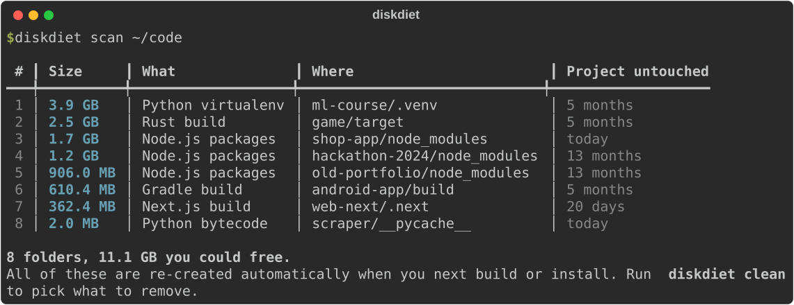

<h1 align="center">diskdiet</h1>

<p align="center">
  <b>Free up disk space safely.</b><br>
  Find old <code>node_modules</code>, Python venvs, build folders, duplicate files and forgotten big files,<br>
  and tidy your messy Downloads folder. Nothing is deleted without asking, and there's undo.
</p>

<p align="center">
  <a href="https://github.com/Ee0422/diskdiet/actions/workflows/ci.yml"></a>
  
  
  <a href="LICENSE"></a>
</p>

<p align="center">
  
</p>

## Why

If you write code, your disk is quietly filling up with folders that tools can re-create in
seconds: `node_modules` in every project you ever cloned, Python virtual environments from that
course you finished last year, Rust `target` folders, Gradle builds, Next.js caches...
It's common to find **10 to 50 GB** of this.

Meanwhile, your Downloads folder has 400 files called `IMG_2041 (3).jpg` and `setup (2).exe`.

`diskdiet` finds all of it in one place and lets you clean it up without fear.

## Install

```bash
pipx install git+https://github.com/Ee0422/diskdiet
```

No `pipx`? Use `pip install git+https://github.com/Ee0422/diskdiet` instead.
Works on Windows, macOS and Linux with Python 3.9 or newer.

## Use it

```bash
diskdiet scan                  # what coding leftovers are taking space? (looks in your home folder)
diskdiet clean                 # pick which ones to remove
diskdiet clean --older-than 90 # only projects you haven't touched in 3 months

diskdiet dupes                 # find duplicate files
diskdiet dupes --clean         # remove the extra copies (the oldest copy is always kept)
diskdiet big                   # list files over 500 MB

diskdiet tidy                  # sort ~/Downloads into Images/, Documents/, Installers/...
diskdiet undo                  # put everything back
```

Every command takes a folder, for example `diskdiet scan ~/code` or `diskdiet tidy D:\Downloads`.
Add `--dry-run` to see what would happen without changing anything, or `--json` for scripts.

### Picking what to clean

`diskdiet clean` shows a numbered list, biggest first, then asks:

```
Which ones? (e.g. 1,3,5-7 / all / none): 1,2,4-5
Move 4 folders (8.5 GB) to the Trash? [y/N] y
Done. Freed about 8.5 GB (4 folders moved to the Trash).
```

### Tidying Downloads

```
$ diskdiet tidy
Plan for /Users/you/Downloads:

 Folder      ┃ Files ┃ For example
━━━━━━━━━━━━━╇━━━━━━━╇━━━━━━━━━━━━━━━━━━━━━━━━━━━━━━━━━━━━━━━━━━━━
 Images/     │   142 │ IMG_2041.jpg, IMG_2042.jpg, screenshot.png, ...
 Documents/  │    87 │ invoice-march.pdf, resume_final_v3.docx, ...
 Installers/ │    23 │ zoom_installer.exe, node-v22.pkg, ...
 Archives/   │    19 │ archive.zip, photos.tar.gz, ...

271 files would be sorted into folders. Folders and files still downloading are left alone.
Go ahead? [y/N]
```

## Safe by design

- **Nothing happens without your OK.** Every cleaning command shows you the list and asks first.
- **Deleted means Trash, not gone.** Folders and files go to the Recycle Bin / Trash, so you can
  restore them.
- **Undo for tidying.** Each `tidy` writes a small record of every move, and `diskdiet undo`
  reverses it.
- **Evidence, not guesses.** A folder named `build` is only flagged if its project has a
  `build.gradle`; a `venv` only if it contains `pyvenv.cfg`; `target` only next to `Cargo.toml`
  or `pom.xml`. Your school folder called `build` is safe.
- **Never overwrites.** If `Images/cat.jpg` already exists, the new one becomes `cat (1).jpg`.
- **Leaves in-progress downloads alone** (`.crdownload`, `.part`...) and skips `.git` folders.
- **Big files are only listed**, never removed for you.

## What it finds

| Ecosystem | Folders |
|---|---|
| JavaScript / TypeScript | `node_modules`, `.next`, `.nuxt`, `.svelte-kit`, `.turbo`, `.parcel-cache`, `.angular` |
| Python | virtualenvs (`.venv`, `venv`, `env`), `__pycache__`, `.pytest_cache`, `.mypy_cache`, `.ruff_cache`, `.tox`, `.nox` |
| Rust | `target` |
| Java / Kotlin | Maven `target`, Gradle `build` and `.gradle` |
| .NET | `bin`, `obj` |
| iOS / Flutter / Dart | `Pods`, `.dart_tool`, Flutter `build` |
| Others | Elixir `_build` and `deps`, Terraform `.terraform`, Zig cache, Unity `Library` |

Missing your favourite? Adding one is a single line in
[`src/diskdiet/junk.py`](src/diskdiet/junk.py). Pull requests are very welcome.

## FAQ

**Is it safe to delete `node_modules` / a venv?**
Yes. They are downloaded copies of your dependencies. Run `npm install` or
`pip install -r requirements.txt` in the project and they come back.

**I cleaned up but my free space didn't change.**
Empty your Trash / Recycle Bin. That's when the space is really freed.

**How does it find duplicates without taking forever?**
Files are grouped by size first, then compared by a hash of the first 64 KB, and only then fully
hashed. Most files are ruled out without being read at all. Hard links are not counted as
duplicates.

## Contributing

```bash
git clone https://github.com/Ee0422/diskdiet
cd diskdiet
pip install -e ".[dev]"
pytest
ruff check .
```

Ideas, bug reports and new folder rules are all welcome in
[issues](https://github.com/Ee0422/diskdiet/issues).

## License

[MIT](LICENSE)
